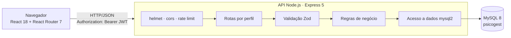

# Arquitetura



Em desenvolvimento o Vite serve o front em `:5173` e a API roda em `:3333`. No build de produção a própria API serve o front compilado (`frontend/dist`).

## Tecnologias

| Camada | Tecnologia | Uso |
| --- | --- | --- |
| Front | React 18, React Router 7, Vite 7, TypeScript | SPA com telas por perfil |
| API | Node.js 22/24, Express 5, TypeScript | REST, roteamento, tratamento central de erros |
| Validação | Zod | Toda entrada (body e query) |
| Autenticação | jsonwebtoken (HS256, 8 h), bcryptjs (custo 12) | Login e hash de senha |
| Segurança | helmet, express-rate-limit, AES-256-GCM (`node:crypto`) | Cabeçalhos, limite de login, anotações cifradas |
| Banco | MySQL 8, mysql2 | Persistência, integridade, triggers |
| Testes | `node:test` + tsx | Testes de integração da API contra MySQL real |
| CI | GitHub Actions | typecheck + testes + build a cada push/PR |

## Organização do código

```
psicogest.sql              Banco: estrutura, restrições, triggers e dados fictícios
backend/src/
  index.ts                 Sobe o servidor
  app.ts                   Monta o Express: middlewares, rotas por perfil, tratador de erros
  config.ts                Lê variáveis de ambiente (.env)
  db.ts                    Pool mysql2 e helpers de consulta/transação
  middleware/auth.ts       requireAuth (JWT + relê usuário do banco) e requireRole
  routes/                  Uma rota por recurso: auth, admin, patients, sessions, summary,
                           profile, requests (psicólogo + cliente), logs
  users.ts, profile.ts     Regras de cadastro de usuário e de perfil profissional
  audit.ts                 Grava em logs_acoes
  crypto.ts                Cifra/decifra anotações (AES-256-GCM)
  http.ts                  HttpError (status + mensagem segura)
  app.test.ts              Testes de integração
frontend/src/
  App.tsx                  Rotas por perfil
  api.ts                   Cliente HTTP (token no localStorage)
  auth.tsx                 Contexto de login/logout
  pages/                   Uma tela por arquivo
  components/              Formulários, modal, lista de logs, UI comum
```

## Fluxo de uma requisição

1. O front envia `Authorization: Bearer <token>`.
2. `requireAuth` valida o JWT e **relê o usuário no banco** — perfil e situação nunca vêm do token, então bloquear ou trocar o perfil vale na hora.
3. `requireRole` confere o perfil exigido pelo grupo de rotas (`/api/admin` → admin, `/api/patients` → psicólogo, `/api/client` → cliente).
4. A rota valida a entrada com Zod e consulta sempre filtrando pelo dono (`psicologo_id` do usuário logado).
5. Ações relevantes gravam em `logs_acoes`.
6. Erros caem num tratador único: Zod → 400, `HttpError` → status próprio, resto → 500 com mensagem genérica.

## Segurança

| Ameaça | Medida |
| --- | --- |
| Vazamento de senha | bcrypt; a coluna `senha_hash` nunca é retornada pela API |
| Força bruta no login | `express-rate-limit` em `/api/auth/login` e `/register` |
| Escalada de privilégio | Autorização no back-end por grupo de rotas; cadastro público não cria admin; ninguém altera o próprio acesso |
| Acesso a dados alheios | Toda consulta do psicólogo filtra pelo vínculo com ele |
| Vazamento clínico | Anotações cifradas com AES-256-GCM (`NOTES_KEY`); nunca vão para log nem para o cliente |
| Adulteração de auditoria | Triggers recusam `UPDATE`/`DELETE` em `logs_acoes` |
| SQL injection | Consultas parametrizadas (mysql2) |
| Segredos no código | `.env` fora do Git; em produção a API não sobe sem `JWT_SECRET` e `NOTES_KEY` |
