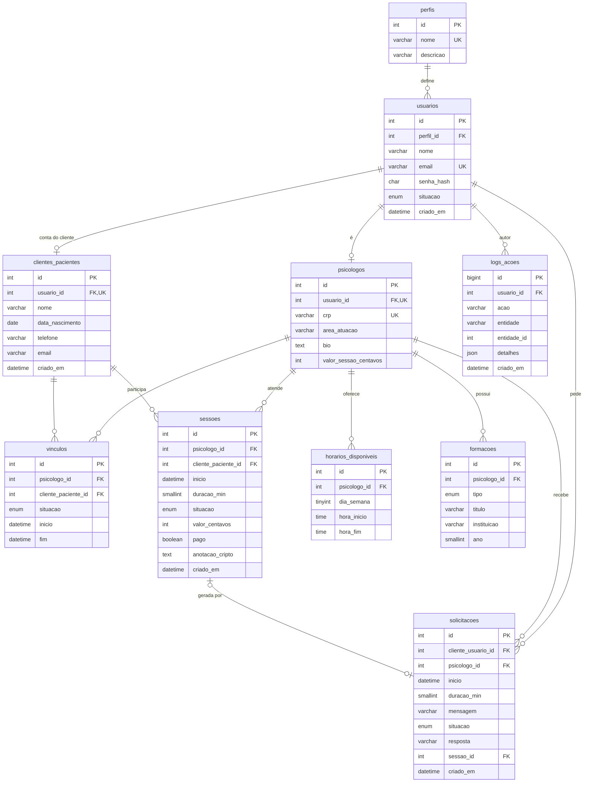

# Banco de dados

Script único: [`psicogest.sql`](../psicogest.sql) — cria o banco `psicogest`, as tabelas, chaves, restrições, triggers e os dados fictícios.
O script apaga e recria o banco a cada execução.

## Diagrama entidade-relacionamento

## Dicionário de dados

### `perfis` — perfis de acesso
| Coluna | Tipo | Regras | Descrição |
| --- | --- | --- | --- |
| id | INT | PK, auto | |
| nome | VARCHAR(30) | NOT NULL, UNIQUE | `admin`, `psicologo`, `cliente` |
| descricao | VARCHAR(200) | NOT NULL | |

### `usuarios` — contas
| Coluna | Tipo | Regras | Descrição |
| --- | --- | --- | --- |
| id | INT | PK, auto | |
| perfil_id | INT | NOT NULL, FK → perfis | |
| nome | VARCHAR(120) | NOT NULL | |
| email | VARCHAR(190) | NOT NULL, UNIQUE | Login |
| senha_hash | CHAR(60) | NOT NULL | Hash bcrypt; nunca retornado pela API |
| situacao | ENUM | `ativo`/`inativo`/`bloqueado`, padrão `ativo` | Só `ativo` acessa |
| criado_em | DATETIME | padrão agora | |

### `psicologos` — dados profissionais (1:1 com usuário)
| Coluna | Tipo | Regras | Descrição |
| --- | --- | --- | --- |
| id | INT | PK, auto | |
| usuario_id | INT | NOT NULL, UNIQUE, FK → usuarios (CASCADE) | |
| crp | VARCHAR(12) | NOT NULL, UNIQUE | Formato `03/12345` |
| area_atuacao | VARCHAR(120) | | Clínica, Escolar, Organizacional… |
| bio | TEXT | | Apresentação pública |
| valor_sessao_centavos | INT UNSIGNED | padrão 0 | Valor em centavos |

### `clientes_pacientes` — dados administrativos
| Coluna | Tipo | Regras | Descrição |
| --- | --- | --- | --- |
| id | INT | PK, auto | |
| usuario_id | INT | UNIQUE, FK → usuarios, opcional | Preenchido quando o paciente tem conta de cliente |
| nome | VARCHAR(120) | NOT NULL | |
| data_nascimento | DATE | | |
| telefone | VARCHAR(30) | | |
| email | VARCHAR(190) | | Contato (não é login) |
| criado_em | DATETIME | padrão agora | |

### `vinculos` — psicólogo ↔ paciente
| Coluna | Tipo | Regras | Descrição |
| --- | --- | --- | --- |
| id | INT | PK, auto | |
| psicologo_id | INT | FK → psicologos (CASCADE) | |
| cliente_paciente_id | INT | FK → clientes_pacientes (CASCADE) | |
| situacao | ENUM | `ativo`/`encerrado` | `encerrado` = paciente arquivado |
| inicio / fim | DATETIME | | Período do vínculo |
| | | UNIQUE (psicologo_id, cliente_paciente_id) | Um vínculo por par |

### `sessoes` — atendimentos
| Coluna | Tipo | Regras | Descrição |
| --- | --- | --- | --- |
| id | INT | PK, auto | |
| psicologo_id | INT | FK → psicologos (CASCADE) | |
| cliente_paciente_id | INT | FK → clientes_pacientes (CASCADE) | |
| inicio | DATETIME | NOT NULL, índice com psicologo_id | |
| duracao_min | SMALLINT | CHECK 10–240, padrão 50 | |
| situacao | ENUM | `agendada`/`realizada`/`cancelada`/`faltou` | |
| valor_centavos | INT UNSIGNED | padrão 0 | |
| pago | BOOLEAN | padrão FALSE | |
| anotacao_cripto | TEXT | | Anotação cifrada AES-256-GCM |
| criado_em | DATETIME | padrão agora | |

### `horarios_disponiveis` — janelas semanais de atendimento
| Coluna | Tipo | Regras | Descrição |
| --- | --- | --- | --- |
| id | INT | PK, auto | |
| psicologo_id | INT | FK → psicologos (CASCADE) | |
| dia_semana | TINYINT | CHECK 0–6 | 0 = domingo |
| hora_inicio / hora_fim | TIME | CHECK início < fim | |

### `formacoes` — cursos e certificados
| Coluna | Tipo | Regras | Descrição |
| --- | --- | --- | --- |
| id | INT | PK, auto | |
| psicologo_id | INT | FK → psicologos (CASCADE) | |
| tipo | ENUM | `certificado`/`curso` | |
| titulo | VARCHAR(160) | NOT NULL | |
| instituicao | VARCHAR(160) | | |
| ano | SMALLINT | | |

### `solicitacoes` — entidade de inovação (pedidos de horário)
| Coluna | Tipo | Regras | Descrição |
| --- | --- | --- | --- |
| id | INT | PK, auto | |
| cliente_usuario_id | INT | FK → usuarios | Quem pediu |
| psicologo_id | INT | FK → psicologos (CASCADE), índice com situacao | |
| inicio | DATETIME | NOT NULL | Horário pedido |
| duracao_min | SMALLINT | padrão 50 | |
| mensagem | VARCHAR(500) | | Recado do cliente |
| situacao | ENUM | `pendente`/`aceita`/`recusada`/`cancelada` | |
| resposta | VARCHAR(500) | | Recado do psicólogo |
| sessao_id | INT | FK → sessoes (SET NULL) | Sessão criada ao aceitar |
| criado_em | DATETIME | padrão agora | |

### `logs_acoes` — auditoria somente-inserção
| Coluna | Tipo | Regras | Descrição |
| --- | --- | --- | --- |
| id | BIGINT | PK, auto | |
| usuario_id | INT | FK → usuarios, índice | Autor (nulo em tentativa de login com e-mail inexistente) |
| acao | VARCHAR(40) | NOT NULL | Ex.: `login`, `usuario_bloqueado`, `sessao_agendada` |
| entidade | VARCHAR(20) | NOT NULL | Ex.: `usuario`, `sessao` |
| entidade_id | INT | | |
| detalhes | JSON | | Nunca contém conteúdo clínico |
| criado_em | DATETIME(3) | padrão agora | |

Triggers `logs_acoes_sem_update` e `logs_acoes_sem_delete` recusam qualquer `UPDATE` ou `DELETE` na tabela.

## Dados fictícios

O script cria 5 usuários (1 admin, psicólogos e cliente), pacientes, vínculos, sessões, horários e solicitações de exemplo.
As contas de demonstração estão em [Instalação](Instalacao.md).
