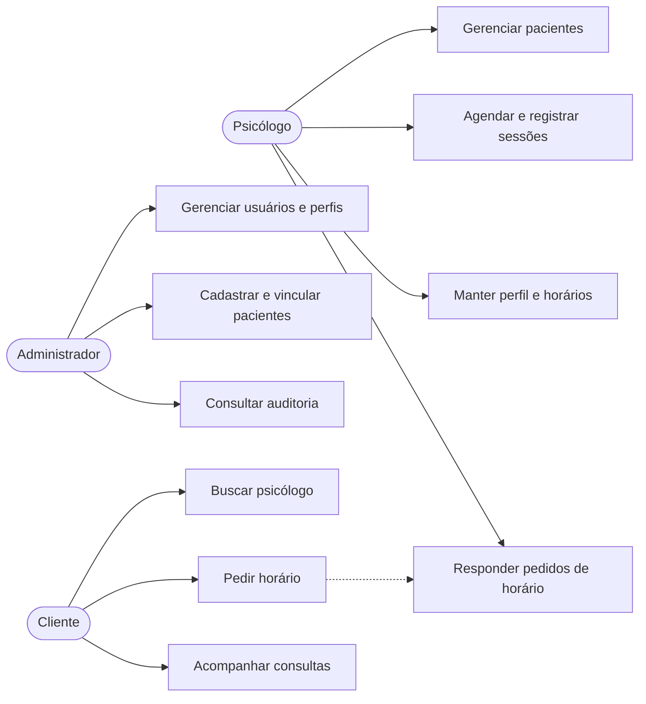

# Casos de uso

## Histórias de usuário

### Todos
- **HU01 — Entrar.** Como usuário, quero entrar com e-mail e senha para acessar meu painel.
  *Aceite:* credenciais erradas → "E-mail ou senha incorretos"; conta bloqueada/inativa → acesso negado; sucesso → painel do meu perfil.
- **HU02 — Sair.** Como usuário, quero sair para que ninguém use minha sessão no mesmo computador.

### Administrador
- **HU03 — Visão geral.** Quero ver totais de usuários, psicólogos e pacientes e as contas por situação.
- **HU04 — Gerenciar contas.** Quero cadastrar, editar, ativar, bloquear e inativar usuários e definir seu perfil.
  *Aceite:* bloquear uma conta derruba o acesso dela na próxima requisição; não consigo alterar o meu próprio acesso.
- **HU05 — Pacientes.** Quero cadastrar um paciente já vinculado a um psicólogo, ou mudar o vínculo.
- **HU06 — Auditoria.** Quero consultar quem fez o quê e quando, sem poder apagar registros.

### Psicólogo
- **HU07 — Meu dia.** Quero ver as sessões de hoje e indicadores da semana (sessões, valor a receber, comparecimento).
- **HU08 — Pacientes.** Quero cadastrar, buscar, editar, arquivar e reativar pacientes.
  *Aceite:* paciente arquivado não aceita novos agendamentos; outro psicólogo não vê meus pacientes.
- **HU09 — Agenda.** Quero agendar sessões únicas ou semanais sem conflito de horário.
  *Aceite:* horário sobreposto é recusado; numa série semanal, se uma data colidir, nenhuma é criada.
- **HU10 — Anotações.** Quero anotar cada sessão com sigilo.
  *Aceite:* a anotação fica criptografada no banco e nunca aparece em logs nem para o cliente.
- **HU11 — Perfil.** Quero manter área, apresentação, valor, horários de atendimento e formação.
- **HU12 — Pedidos.** Quero aceitar ou recusar pedidos de horário (ver [Inovação](Inovacao.md)).

### Cliente
- **HU13 — Encontrar.** Quero buscar psicólogos por nome ou área e ver o perfil e os horários livres.
- **HU14 — Pedir horário.** Quero pedir um horário livre e poder cancelar enquanto estiver pendente.
- **HU15 — Minhas consultas.** Quero ver minhas consultas confirmadas.
