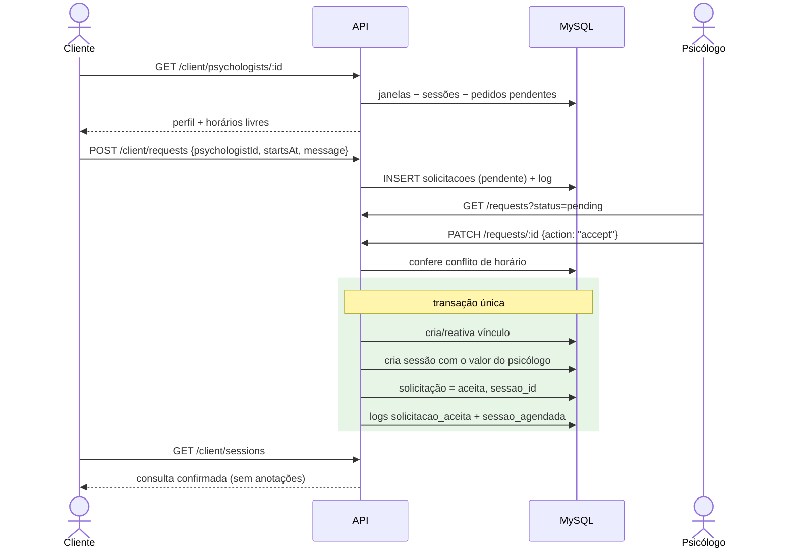
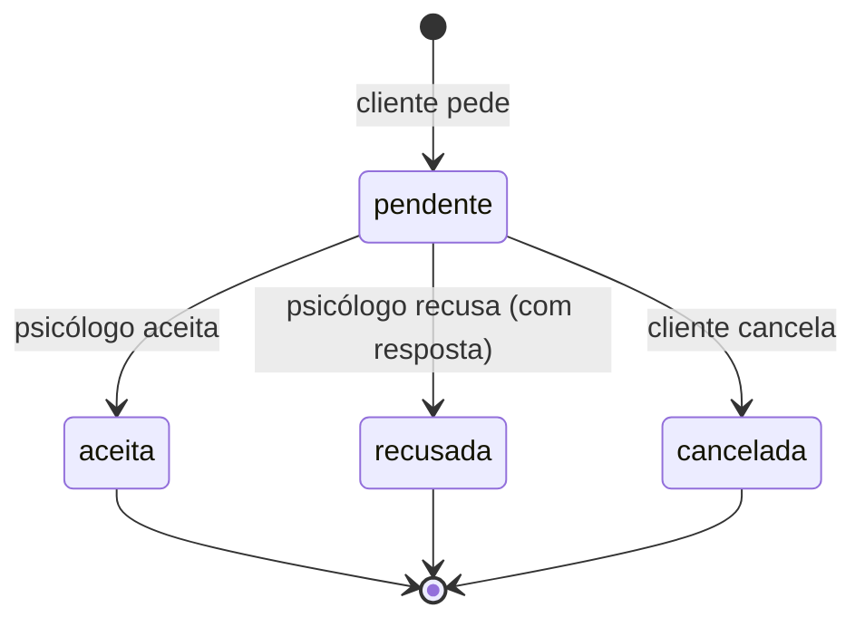

# Inovação: agenda com confirmação

**Problema:** marcar consulta hoje é troca de mensagens — "tem horário quinta?", "só às 15h", "pode ser". O psicólogo perde
tempo, horários se chocam e nada fica registrado.

**Solução:** o cliente vê só os horários realmente livres do psicólogo e faz o pedido pelo sistema. O psicólogo confirma ou
recusa com um clique. Ao confirmar, o vínculo e a sessão nascem juntos, sem redigitar nada.

## Como os horários livres são calculados

Horários livres = janelas semanais de atendimento (`horarios_disponiveis`) **menos** sessões já agendadas **menos** pedidos
ainda pendentes. Assim dois clientes não pedem o mesmo horário e o psicólogo nunca recebe pedido para um horário ocupado.

## Fluxo

## Estados de uma solicitação

## Regras

- Só pedidos `pendente` podem ser respondidos ou cancelados (senão 409).
- Não dá para aceitar horário que já passou, nem horário que ficou ocupado depois do pedido.
- Aceitar é tudo-ou-nada: se qualquer passo falhar, nada é gravado.
- O cliente nunca vê anotações clínicas.

**Entidade de inovação no banco:** `solicitacoes` (ver [Banco de dados](Banco-de-Dados.md)).

## Valor gerado

- Menos troca de mensagens e nenhum choque de horário.
- O cliente se cadastra sozinho; o psicólogo não redigita dados.
- Todo pedido e resposta ficam registrados na auditoria.
