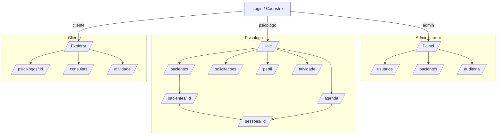

# Telas e fluxo de navegação

Sem login, qualquer endereço mostra a tela de **Login** (com cadastro público e botões de acesso rápido às contas de demonstração).
Depois do login, o front monta só as rotas do perfil — isso é conforto de navegação; a segurança real está no back-end.

| Perfil | Rota | Tela (`frontend/src/pages`) | O que faz |
| --- | --- | --- | --- |
| Todos | — | `Login.tsx` | Login, cadastro de psicólogo/cliente, acesso rápido demo |
| Admin | `/` | `AdminHome.tsx` | Totais e contas por situação/perfil |
| Admin | `/usuarios` | `AdminUsers.tsx` | Busca, filtro, cadastro, edição, ativar/bloquear/inativar, perfil |
| Admin | `/pacientes` | `AdminPatients.tsx` | Pacientes de todos os psicólogos, cadastro com vínculo |
| Admin | `/auditoria` | `AdminAudit.tsx` | Log completo com busca |
| Psicólogo | `/` | `Today.tsx` | Sessões de hoje e indicadores |
| Psicólogo | `/agenda` | `Agenda.tsx` | Visão semanal e mensal, nova sessão (única ou semanal) |
| Psicólogo | `/pacientes` | `Patients.tsx` | Busca, ativos/arquivados, novo paciente |
| Psicólogo | `/pacientes/:id` | `PatientDetail.tsx` | Dados e histórico de sessões do paciente |
| Psicólogo | `/sessoes/:id` | `SessionDetail.tsx` | Situação, pagamento e anotação criptografada |
| Psicólogo | `/solicitacoes` | `Requests.tsx` | Aceitar/recusar pedidos de horário |
| Psicólogo | `/perfil` | `Profile.tsx` | Dados profissionais, horários, formação |
| Psicólogo / Cliente | `/atividade` | `Activity.tsx` | Histórico de ações do próprio usuário |
| Cliente | `/` | `Explore.tsx` | Busca de psicólogos por nome/área |
| Cliente | `/psicologos/:id` | `PsychologistPublic.tsx` | Perfil público, horários livres, pedir horário |
| Cliente | `/consultas` | `MyAppointments.tsx` | Pedidos e consultas confirmadas |

## Capturas de tela

> Adicionar as capturas em `docs/img/` e referenciar aqui (``): login, painel admin, usuários,
> painel do psicólogo, agenda, detalhe da sessão, solicitações, explorar (cliente) e perfil público.
